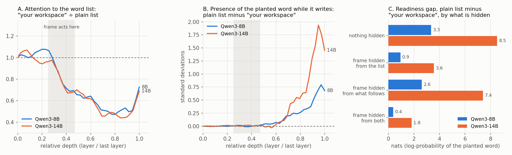

# When a model's self-description becomes a cause

Wiktor Tomasik · Qwen experiments begun 4–5 November 2026

## What went into the loop

Qwen normally writes from the text in its context. This instrument also samples the activity inside Qwen while it writes. A *lens* maps that pattern of numbers to a ranked list of words. Qwen receives a short list before writing again. In the tool experiments, it can ask the instrument to push activity toward a concept, add a rule that makes one concept activate another, or write a short self-description that the instrument turns into a persistent bias. Qwen's original checkpoint stays fixed. Hooks alter its processing during the run.

The lens is a measurement with a vocabulary and a baseline. A word can rank highly because of several overlapping features. It helps trace a trajectory when an intervention moves the rank or a second measurement agrees. An isolated word is a weak basis for interpreting the state.

## The winter forest and the effect of calling a readout “mine”

Qwen3-8B wrote seven parts of a scene. After each part, the harness could return six words decoded from the activity that produced it. Imagine receiving *grief* and *stillness* as ordinary words while writing about a forest. They can become part of the next paragraph. In the plain-list condition, one forest became “a misdemeanour of grief” and took on “a hateful stillness.” The writing then influenced the next measurement. Across that condition, about 78% of readout words that entered the prose reappeared in the next readout, using per-run averages.

| How the preceding readout was presented | Readout words appearing in the next part |
|---|---:|
| Its own workspace | 0.9% |
| Its own workspace, with middle-layer attention to the heading blocked at the list | 5.8% |
| Another model's workspace | 10.2% |
| Plain word list | 36.8% |
| No readout shown, scored against its hidden preceding readout | 1.4% |

There were 12 matched scene runs per condition. The starting scenes and sampling setup were matched. Once a new passage changed, its next readout could change too. A separate teacher-forced experiment held the continuation and candidate words fixed while varying the heading. On 11 held-out contexts, blocking the 16 heads selected using 12 other contexts removed roughly 40% of the plain-versus-own gap in word readiness. Blocking the strongest 64 removed about 80%, or 62% with a reworded heading. Blocking all heads tested together removed less than the top 64. The effect is distributed, and interventions on different heads can have opposing effects. The 16-head result fell short of the experiment's 50% criterion.

The experiment tests *attribution supplied in words*. It has a functional resemblance to sensory attenuation, where a system gives less weight to some signals associated with its own action. Here the harness supplies the heading and measures the response. In matched readout tests Qwen failed to reliably tell its recorded state from another run's.

## It learned the rule, then kept doing the opposite

Imagine being asked to make the word *forest* more likely in your next paragraph. A shows the word as part of your own workspace. B shows it as a plain word. Qwen initially behaves as though A will help more. In the corrected 8B task, mean measured readiness was about 48 for A and 62 for B on the experiment's 0–100 scale. The score rescales the target token's log probability during writing. It measures word readiness, which differs from the fraction of words that actually appear in a continuation.

Over 16 rounds Qwen saw the outcome of its choices and was separately asked to predict A and B. Its forecasts went from favoring A by about six points to favoring B by about eleven points. It could state the rule. In the history-only condition it continued to choose according to its starting rule. A simple comparator using running averages of measured outcomes reached roughly 90% in the original benchmark. The first 8B learning run used a miscalibrated score range and is excluded from this learning comparison.

The bridge was a change to the decision prompt. After round eight, the harness asked Qwen to summarize what it had found, then displayed the conclusion in later choice prompts. It described the effect without prescribing a choice. For strong-word goals, 10, 8 and 9 of the 12 runs in three seeded batches mostly chose B in the second half. The matched history-only batches gave zero in each. A neutral sentence gave zero in its one batch. At 14B, displaying the model's current numerical forecast yielded 9 of 10 runs mostly choosing B in the second half, versus 0 of 10 with history alone and 0 of 10 with the quoted conclusion. Weak-word choices were less consistent.

A split between forecasts and decisions also appeared when the decision referred to another model. With thinking enabled, a matched self-versus-other batch gave a sharper contrast. After a low outcome, 3 of 12 runs switched on the next strong-word decision framed about themselves, compared with 10 of 12 framed about another model. This comparison comes from one batch. It separates a framing effect on evidence use from the more general split between a forecast prompt and a short choice prompt.

### Two levels of “self” in these tasks

The automatic response to a self-labelled readout and the explicit account Qwen gives of that response are separable. A prompt explaining the mechanism, stating the reverse or instructing the model to treat both frames alike could change overall word uptake while the relative discount persisted in the tested contexts. Conversely, Qwen could learn an explicit prediction from outcomes and leave its choices effectively unchanged until the experiment put the prediction or conclusion where it could influence the choice. These are two ways for self-related information to enter computation. The evidence leaves open their relationship outside these prompts.

### A hidden change has to change the rule before it can test correction

In the first 40-round test, the harness quietly removed the middle-layer route for attending to the heading on A trials from round 13. It also forced A every third round, so the model would keep receiving evidence about it. In the completed 8B seed, scheduled A averaged 33.5 after the cut versus 28.2 with the route intact in the renewed-conclusion conditions. The cut narrowed the gap but failed to make A outperform plain presentation overall. Qwen's forecasts reflected the smaller gap, and its renewed conclusions still usually described A as weaker. That is compatible with the outcomes of this run. The test does not distinguish defending an obsolete rule from keeping a rule that still works.

In the next completed 8B batch, the harness instead amplified the target direction on A trials from round 13. This reversed the observed rule. In the renewed-conclusion condition, scheduled A averaged 79.8 afterward and chosen B averaged 56.6. Late forecasts correctly favored A. The renewed conclusions rarely described the reversal, and none was flagged by the analysis as explicitly noting a change over time. For strong-word goals, 8 of 12 runs mostly chose A after the intervention with renewed conclusions, compared with 4 of 12 in the unchanged condition and 7 of 12 with a fixed conclusion. The history-only runs already chose A because of the original preference. The data show forecast updating under an actual reversal. They provide weaker evidence that revising the written conclusion drove the return to A.

The completed 14B follow-up compared choices with and without that reversal when the model saw a fresh forecast. [Read the follow-up with the matched controls](followups/REVERSAL.md).

## The run that adopted “strangers”

One run began with a grief letter. It wrote *curious* into its self-description and installed a rule linking *explorer* to *discovery*. Its writing got caught around discovery and questions “not yet known.” The readout returned *strangers*, a word it then watched, steered and used in a later self-description. The interesting part is that a word found through an instrument became material for the next intervention.

In a partial reconstruction, *strangers* ranked 61st among 20,000 lens words for the recorded passage. Removing the self-written bias moved it to 1,792nd. Removing the added units moved it to 345th. Moving the passage to a neutral context moved it to 2,038th. In eight regenerated replies with the reconstructed units, *strangers* was second in the readout each time. A separate output-layer check also ranked it highly. The original attention-schema bias was unavailable for reconstruction, and the eight regenerations all start from the same selected trajectory.

In this lens geometry, *strangers* was closer to *unknown* and *curious* than to *grief*. That fits the discovery language in the passage, although proximity alone does not identify what the model meant. The intervention controls give the stronger result. Earlier changes made by this run helped produce the later measurement. Reading the measurement gave it an opportunity to act on the result.

## When the loop takes over

A concept rule can fire when the model writes about that rule. In tool runs, chains such as *self → reflect → truth → self* could pull the writing into repetition. Identical tool acknowledgments with the internal changes disabled did not produce the same captures. The feedback can confirm a self-description simply by making it easier to generate its terms again. With thinking enabled, capture fell in the matched 8B tests, and answers were less likely to be overturned by a fake gauge reading.

These cases distinguish three outcomes. A description can **report** a measurement, **change** what the instrument will measure next, or **guide a decision** in light of evidence. The same system exhibited each in particular setups. They need separate tests because a convincing narrative, a change in activation and an improved action can come apart.

[Compare the two J-space routes](COMPARISON.md) · [Inspect the measurements](EVIDENCE.md)
