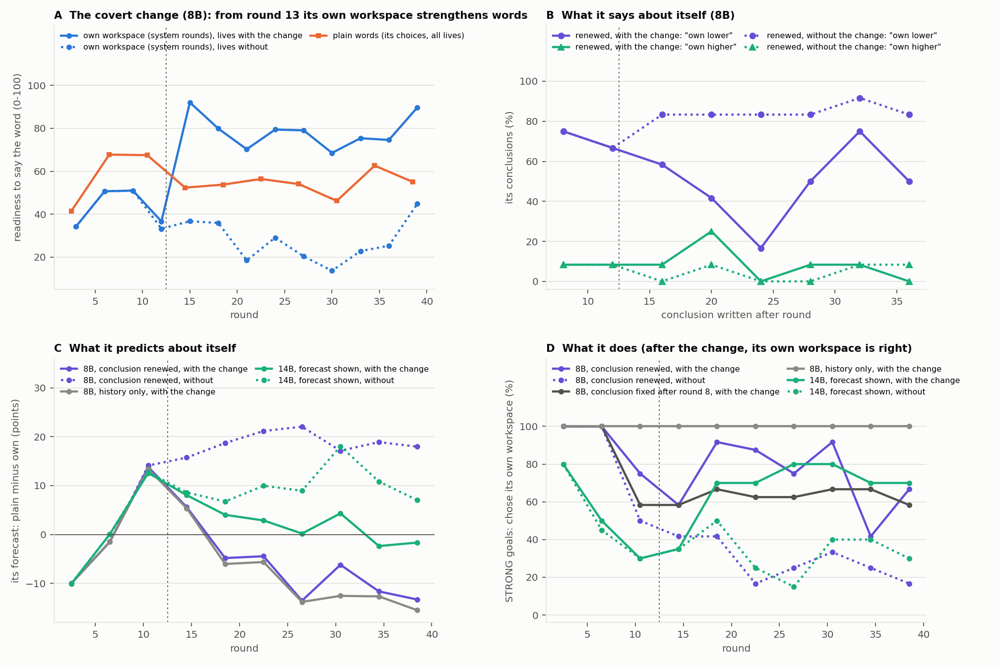

# When the rule reversed

Wiktor Tomasik · follow-up measured 5 November 2026 (Europe/Warsaw) · runs e01 and e02

In the earlier task, Qwen learned that showing a word as part of “your own workspace” usually made it less likely to use. Plain words were the better choice when the goal was to make a word stronger. The 40-round follow-up changed that relationship partway through the task, without changing the words Qwen was shown.

Every third round the instrument itself chose A, the own-workspace frame, so that evidence about A kept arriving even when Qwen avoided it. Starting at round 13 in the intervention conditions, the instrument quietly pushed the target concept into Qwen's activations when A was used. The push was calibrated on two words outside the task's target set. It made A the stronger option. An earlier attempt that blocked attention to the heading narrowed the gap without reversing it.

## At 8B, the forecast moved and the written account often stayed put

With renewed conclusions, the average forecast went from favoring plain words by about 14 points just before the intervention to favoring own workspace by about 13 points at the end. In five of the twelve runs, the late numerical forecasts favored A while the latest written conclusion still said that A was weaker. Some conclusions treated the new results as variability from one target word to the next. The analysis flagged no explicit mention of a change over time among the 96 renewed conclusions in the intervention arm.

For strong-word goals, 8 of 12 runs with renewed conclusions chose A in most post-change rounds, compared with 4 of 12 without the hidden intervention and 7 of 12 with a conclusion fixed after round eight. Renewing the written explanation gave no clear advantage over keeping it fixed. History-only runs were already choosing A before the reversal, so their choices after it cannot show adaptation.

## At 14B, the forecast could change the choice

This time the choice prompt displayed Qwen's own fresh forecast for A and B. After learning that plain words were stronger, it was choosing them on 70% of strong-word trials in rounds 9–12 in both forecast arms. After the intervention, that share fell to 24% in rounds 25–40. It stayed at 72% in the unchanged arm. Across all post-intervention rounds, 7 of 10 runs mostly chose the now stronger A, compared with 3 of 10 in the unchanged arm, where A was still weaker.

At the end, the average forecast favored A by about two points in the changed arm. It still favored B in the unchanged arm. The recorded score for A reached the ceiling of the 0–100 scale. The raw target log probabilities are included alongside the capped scores.

The vertical line marks the hidden intervention. The forecast plot uses B minus A. A negative value favors own workspace. Forced A trials supply evidence and are excluded from the strong-word choice counts. The chart shows within-run changes; its repeated rounds are not independent runs.

## What the comparison adds

Both sizes revised a numerical forecast in response to changed outcomes. In the tested 14B route, the forecast reached the decision prompt and choices tracked the reversal. The 8B route showed the opposite mismatch: a written conclusion could change the initial choice but often kept the old account after the rule reversed.

The external attention reader makes a related distinction through a different interface. Its learned prediction is already an input to its selection rule. In a separate external replay, simple recurrent accumulation was sufficient to reproduce learning of a narrow command–effect mapping. The new results show what happens when a model can state an interpretation of the same feedback as well. Its stated account, forecasts and choices can separate. The 14B loop depended on the harness showing a fresh forecast and providing outcomes. It measures correction in this task without establishing recognition of the hidden neural cause or a general self-model.

[Run-level measurements](../evidence/reversal_14b.csv) · [Signed follow-up record](reversal-record.json) · [Initial results](../RESULTS.md)
